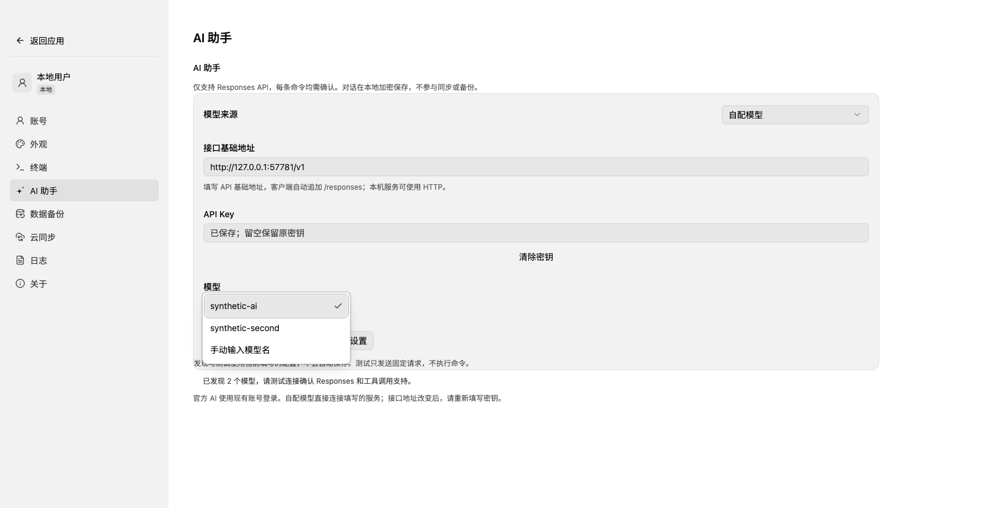
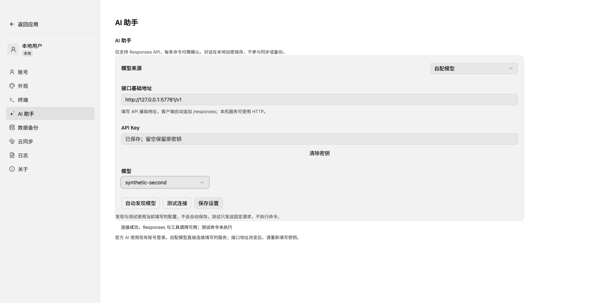

# Responses 单协议、模型发现与连接测试验收

2026-11-02。按用户确认，客户端及独立 admin 的供应商上游均只保留 Responses API；本轮不推送、不部署生产。

## 交付行为

- 删除客户端 Chat Completions 配置、请求构造和流解析，官方固定地址改为 `/api/ai/v1/responses`。自配服务只追加 `/responses`，不保留旧路由和转换层。
- 保留 reasoning/message/function_call 原生返回项，以 `function_call_output` 续接，不依赖供应商保存会话。已有设置保留地址和加密密钥；旧协议对话仍可查看，继续操作须新建对话。
- 设置页增加独立“自动发现模型”“测试连接”“保存设置”。自配从 `/models` 发现模型，支持手动填写；官方从 capabilities 获取公开模型与额度。发现、测试仅使用草稿，不自动保存，不执行测试命令。自配测试最多输出 256 Token。
- 更换接口地址不会复用旧地址密钥；清除已保存密钥不会覆盖未保存的配置草稿。重复点击受到单请求保护，失败保留草稿与反馈。
- 客户端来源/模型使用共享 Select；后台 AI 默认模型、用量模型和状态筛选使用后台共享 SelectControl。

## 后台与迁移

独立 admin 增加 V13：移除旧输出参数列，输出上限统一生成 `max_output_tokens`。保留密钥密文、用户额度、已用、未知预占和请求历史；停用已有模型、使原测试失效并关闭总开关。客户端和后台一起升级后，由管理员重新测试并启用模型，再打开官方 AI。

上游原生终态的 `response.usage` 才可结算。输入与输出合计，缓存/推理明细不重复累计；只有持久化结算及工具校验成功才发出 completed。缺少用量继续保留预占，超预算完整入账并停用模型。默认零额度、北京时间自然日、原子预占、跨实例限流及 110 秒时限继续生效。

## 已执行验证

| 范围 | 结果 |
| --- | --- |
| PostgreSQL 17.11 + 合成 Responses HTTP/SSE | 16 项通过；鉴权、零额度、分配/不足、用量/密钥/审计、并发竞争、跨日、租约恢复、幂等结算、断流、5xx、缺少/异常用量及 110 秒超时 |
| 迁移 | 空库、V11→V13、V12→V13 通过；既有账号/同步/备份不变，密钥/额度/未知计量保留，旧模型须重测 |
| 协议单元 | 4 项通过；原生 reasoning/tool result 续接、服务端预算、终态用量、明细不重算、矛盾用量拒绝 |
| 后台前端 | 33 项通过；类型、lint、构建通过，Java 离线 package 通过 |
| 桌面基础回归 | 189 项通过，1 项跳过（本机未安装 Fish）；含 AI 专项 16 项 |
| 桌面前端 | 904 项通过，含新增设置页 3 项；类型与 lint 通过 |
| 固定格式兼容 | 10 项通过，baseline:verify 通过，未刷新固定证据 |
| Electron 完整构建与 DMG 烟测 | macOS x64 均通过；实际 renderer/preload/main/runtime/SQLite/本机合成 SSH，含模型发现、草稿选择/测试不保存、共享下拉、确认前不执行、拒绝重复确认、断流不生成命令 |

数据库仅操作用户提供服务中的随机隔离 schema；事后只读复查临时 AI schema 为 0，业务 schema 为 1。凭据仅通过进程环境传入，未写入源码和验收文件。本次 Responses 验证仅使用已有工具与缓存，未下载测试工具。

未签名打包版本 `0.5.0-test.362.e196f4a5`，DMG 与 ZIP 位于 `artifacts/desktop`。哈希及验证摘要见 [verification.json](evidence/ai-responses-20261102/verification.json)，运行报告见 [安装包烟测](evidence/ai-responses-20261102/mac-x64-package-smoke.json)。测试结束后清理项目 `artifacts/desktop/mac/eizhu.app` 及其应用登记，保留 `/Applications/eizhu.app`。

## 界面证据

## 待验

真实供应商、生产 Nacos/代理、Docker 镜像，以及 Windows x64/macOS arm64/Linux x64、签名、公证仍待验。本机合成证据不能替代这些验收。接口契约见 [AI_API.md](../AI_API.md)，后台详细记录保留在独立 admin 仓库。
